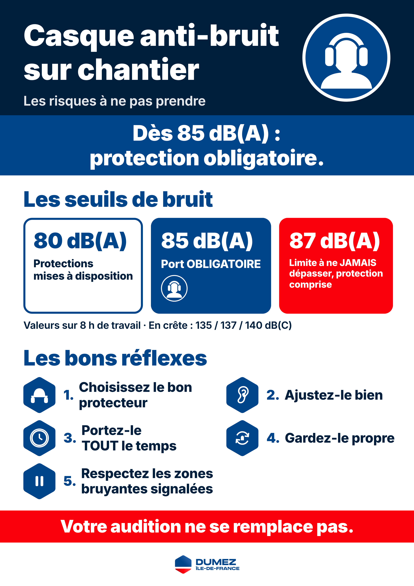

# Casque anti-bruit sur chantier : les risques à ne pas prendre

Vidéo de sensibilisation sécurité en motion design, sans son. Elle est faite pour l'accueil sécurité, les
causeries, les écrans de chantier et WhatsApp. Le message passe uniquement par l'image et par des textes
courts, lisibles par des compagnons peu francophones.

| Livrable | Format | Fichier |
|---|---|---|
| Vidéo projection | 1920×1080 (16:9), 30 i/s, H.264, sans son, **74,9 s** | [`output/securite_bruit_horizontal.mp4`](output/securite_bruit_horizontal.mp4) |
| Vidéo téléphone | 1080×1920 (9:16), 30 i/s, H.264, sans son, 57,7 s | [`output/securite_bruit_vertical.mp4`](output/securite_bruit_vertical.mp4) |
| Affiche | A3 portrait, 3508×4961 px (300 dpi) | [`output/securite_bruit_affiche_A3.png`](output/securite_bruit_affiche_A3.png) |

La version **16:9** contient deux scènes de plus : « Ce qui abîme vos oreilles » et le générique animé du logo. La
vidéo verticale et l'affiche n'ont pas encore ces ajouts : ce sont les versions validées précédemment. Elles
n'ont pas été régénérées.



## Déroulé

| # | Durée | Scène |
|---|---|---|
| 0 | 2 s | Logo Dumez sur une carte blanche, puis titre « Casque anti-bruit sur chantier ». |
| 1 | 4 s | Chantier stylisé. Les ondes sonores grossissent et l'image tremble. « Le bruit ne fait pas mal… » puis, sur un bandeau rouge, « …tant qu'on ne l'a pas perdu. » |
| 2 | 10 s | Jauge verticale à trois paliers. **80 dB(A)** : protections mises à disposition. **85 dB(A)** : port obligatoire, avec le panneau bleu. **87 dB(A)** : limite à ne jamais dépasser, protection comprise. Mentions secondaires : valeurs sur 8 h, crêtes 135 / 137 / 140 dB(C). |
| 3a | 6 s | Pour vos oreilles. La courbe d'audition descend, l'oreille siffle. Quatre effets : acouphènes, fatigue auditive, hyperacousie, perte définitive. |
| 3b | 12 s | Pour le corps et la sécurité : stress, fatigue, sommeil. Un engin recule et l'ouvrier ne l'entend pas : alerte rouge. Puis la même scène **organisée** : protecteur adapté bien porté, gyrophare visible, signaleur et gestes convenus. L'ouvrier s'écarte, l'engin s'arrête. Message fort : « Une oreille abîmée ne se répare pas. » |
| 4 | 14 s | Cinq cartes hexagonales : choisir son protecteur (bouchons, bouchons à cordelette, coquilles sur casque, serre-tête), bien l'ajuster, le porter tout le temps, le garder propre et le remplacer, respecter les zones signalées et les pauses. |
| 5 | 5 s | « Dès 85 dB(A) : protection obligatoire. » puis « Votre audition ne se remplace pas. » Logos sur fond blanc. |

Les transitions sont des **vagues d'hexagones** bleus : c'est la forme du logo Dumez.

### Ajouts de la version 16:9

**« Ce qui abîme vos oreilles »** (12,7 s, entre les seuils et les conséquences) :
- La jauge verticale de dB(A) occupe la gauche, avec la zone rouge au-dessus de 85. Huit cartes hexagonales s'affichent à côté, en grille de 4 × 2, environ une toutes les 0,8 s.
- Les outils sans valeur sourcée viennent d'abord, marqués « Bruyant ». Les autres suivent du moins bruyant au plus bruyant, et chacun monte à son niveau sur la jauge.
- Au-dessus de 85 dB(A), la carte reçoit un liseré rouge et le mini panneau bleu d'obligation. Le pistolet de scellement porte en plus le picto d'impulsion et la mention « Coup sec ».
- « Pas seulement les gros engins. » remplace le titre pendant l'arrivée des outils à main.
- Viennent ensuite « Le niveau ET le temps passé comptent. » et la carte de coactivité : l'ouvrier au marteau-piqueur est protégé, son voisin subit le bruit. Texte : « Le bruit du voisin compte aussi. »
- Mention fixe en bas de la scène : « Ordres de grandeur. Varie selon l'outil, le matériau et le lieu. »

**Générique du logo** (4,1 s, après le message final) :
- Des ondes se resserrent et tracent l'hexagone du logo, pointe en haut, en bleu. Le bas passe ensuite au rouge, avec l'espace blanc comme dans le logo.
- L'hexagone se pose sur celui du logo Dumez, qui apparaît en fondu avec un glissement de 24 px. Le logo n'est ni recoloré ni déformé, et reste plafonné à 1,3 fois sa taille avec sa zone de protection.
- « Protégez votre audition. », puis l'image finale reste 1 s à l'écran.

Temps de chaque scène en 16:9, affiché aussi à la fin du rendu (transition comprise) :

| Scène | Début | Durée |
|---|---|---|
| Ouverture (logo) | 0,0 s | 2,8 s |
| Accroche | 2,8 s | 4,8 s |
| Seuils | 7,5 s | 10,4 s |
| Ce qui abîme vos oreilles | 17,9 s | 12,7 s |
| Conséquences : oreille | 30,6 s | 7,2 s |
| Corps et sécurité | 37,8 s | 13,2 s |
| Bons réflexes | 50,9 s | 14,5 s |
| Message final | 65,4 s | 5,4 s |
| Générique (logo) | 70,8 s | 4,1 s |
| **Total** | | **74,9 s** |

## Règles de contenu

- **Aucun chiffre inventé.** Seuls figurent les seuils réglementaires du Code du travail (art. R4431-2) repris par l'INRS :
  - 80 dB(A) et 135 dB(C) : valeurs d'exposition inférieures déclenchant l'action ;
  - 85 dB(A) et 137 dB(C) : valeurs supérieures ;
  - 87 dB(A) et 140 dB(C) : valeurs limites, atténuation du protecteur comprise.

  Ces valeurs portent sur 8 h de travail.
- **Niveaux des outils : seulement des valeurs sourcées.** Un chiffre n'apparaît que s'il figure dans `sources_bruit` avec sa `source` et sa `fiabilite` (voir plus bas). Sinon, la carte affiche « Bruyant ». Il s'agit d'ordres de grandeur, et la scène le rappelle. L'accroche (scène 1) reste qualitative : « Bruyant » ou « Très bruyant ».

## Identité visuelle

La palette a été extraite du logo `assets/logo_dumez.png`, et **aucune autre couleur n'est utilisée** :

| Rôle | Couleur |
|---|---|
| Bleu Dumez : couleur dominante, titres, cartes, panneau d'obligation | `#004489` (texte « DUMEZ » et haut de l'hexagone) |
| Bleu très foncé : fonds | `#001F3D` (même teinte, assombrie) |
| Rouge Dumez : danger, conséquences, dépassement | `#FA000C` (bas de l'hexagone) |
| Blanc : fonds et textes sur couleur | `#FFFFFF` |

**Contrastes** (norme WCAG), pour une lecture de loin et au soleil :

| Texte | Fond | Contraste |
|---|---|---|
| Blanc | bleu foncé | 16,6:1 |
| Blanc | bleu Dumez | 9,6:1 |
| Blanc | rouge | 4,1:1 |
| Rouge | blanc | 4,1:1 |

Le rouge n'accueille que du texte **très gros et gras** : au moins 64 px en vertical, alors que le seuil « grand texte » est de 3:1. Le rouge sur bleu (2,3:1) n'est jamais utilisé pour du texte.

**Typographie** : Inter, embarquée dans `assets/fonts/` (licence OFL). Elle couvre aussi les accents roumains, polonais, etc.
- Tout texte fait **au moins 64 px en vertical** et 48 px en horizontal.
- Une ligne contient **6 mots au maximum**.
- Le rendu vérifie ces deux règles et le signale si un texte les enfreint.

## Modifier les textes ou traduire

Tous les textes sont dans [`config.json`](config.json), sous `textes.fr`. Un `\n` force un retour à la ligne. Les lignes trop longues sont réduites automatiquement, sans descendre sous le minimum.

Pour **ajouter une langue** (anglais, roumain, portugais…) :

1. Copiez le bloc `"fr": { … }` à côté de lui, sous `textes`, en le renommant par exemple `"ro": { … }`, puis traduisez les valeurs. Une clé absente reprend le texte français.
2. Générez la version : `npm run render -- --lang ro`. Les fichiers prennent le suffixe `_ro`, par exemple `output/securite_bruit_vertical_ro.mp4`.
3. Ou changez `"langue": "ro"` pour en faire la langue par défaut.

Pensez à garder les retours à la ligne courts : 6 mots au maximum par ligne.

## Logos

```json
"logos": {
  "entreprise": "assets/logo_dumez.png",
  "chantier": "",
  "synapsis": "assets/logo_synapsis.png",
  "agrandissement_max": 1.3
},
"show_synapsis_credit": false
```

- **`entreprise`** : le logo affiché en ouverture et en scène finale, sur fond blanc, avec une zone de protection d'au moins la hauteur du « H » de DUMEZ.
  - Il n'est ni déformé ni recoloré, et jamais agrandi au-delà de `agrandissement_max` (1,3 fois). Sur l'affiche, cette limite s'applique aux pixels imprimés.
  - Le fichier actuel fait 421×120 px. **Remplacez-le par une version HD** (PNG transparent, au moins 1500 px de large) : il apparaîtra alors plus grand sans perdre en netteté.
- **`chantier`** : chemin vers un logo de chantier, optionnel. Vide, il n'est pas affiché.
- **`show_synapsis_credit`** : `true` ajoute la ligne « Réalisé par Synapsis » en dernière scène et sur l'affiche.

## Niveaux de bruit des outils et sources

Les valeurs viennent **uniquement** de `sources_bruit` dans `config.json` :

```json
"show_db_values": true,
"sources_bruit": [
  { "id": "marteau_piqueur", "valeur": 110, "source": "…", "fiabilite": "moyenne" },
  { "id": "brise_roche", "valeur": [94, 100], "detail": "…", "source": "…", "fiabilite": "haute" }
]
```

Règles d'affichage :
- `valeur` est un nombre, ou une plage `[min, max]` affichée « ≈ 94 à 100 dB(A) ».
- Une entrée **sans `source` n'affiche aucun chiffre**.
- `"impulsionnel": true` ajoute le picto d'impulsion et la mention « Coup sec ».
- **`show_db_values: false`** masque tous les chiffres d'un coup : les repères de la jauge disparaissent et les cartes affichent « Très bruyant » ou « Bruyant ». Le liseré rouge et le panneau restent, puisqu'ils découlent des valeurs sourcées.

Les cartes sont définies dans `textes.fr.outils`, avec leur nom et leurs `sources`. La carte « Disqueuse, meuleuse » regroupe deux valeurs (94 et 100), d'où la plage.

**Sources utilisées :**

| Outil | Valeur affichée | Source | Fiabilité |
|---|---|---|---|
| Marteau-piqueur | ≈ 110 dB(A) | ASP Construction (Québec), échelle de décibels (données approximatives) | moyenne |
| Pistolet de scellement | ≈ 130 dB(A), impulsionnel | ASP Construction (Québec), échelle de décibels (données approximatives) | moyenne |
| Perforateur, burineur | ≈ 105 dB(A) | Exercice pédagogique de cours | faible |
| Scie à sol | ≈ 106 dB(A) | Exercice pédagogique de cours | faible |
| Disqueuse, meuleuse | ≈ 94 à 100 dB(A) (disqueuse 94, meuleuse 100) | Exercice pédagogique de cours | faible |
| Brise-roche hydraulique sur pelle | ≈ 94 à 100 dB(A) : 94 en moyenne sur 1 h, 100 derrière la pelle en burinage | INRS, fiche « Techniques de réduction du bruit » n°104 | haute |
| Compresseur, groupe électrogène | « Bruyant » (aucune valeur sourcée) | — | — |
| Aiguille vibrante | « Bruyant » (aucune valeur sourcée) | — | — |

Trois valeurs sur sept ont une fiabilité « faible » (exercice de cours). Remplacez-les par des mesures ou des sources publiées dès que possible, ou passez `show_db_values` à `false` en attendant.

## Installation

Il faut **Node.js 18 ou plus récent** et **ffmpeg**.

```bash
cd securite-bruit
npm install                       # GSAP + Playwright (aucune dépendance réseau au rendu)
npx playwright install chromium   # navigateur utilisé pour le rendu (une seule fois)
```

ffmpeg :
- Linux : `sudo apt install ffmpeg`
- macOS : `brew install ffmpeg`
- Windows : `winget install ffmpeg`

## Prévisualiser

```bash
npm run dev
```

Ouvrez ensuite l'une de ces adresses :
- <http://localhost:5174/src/index.html?format=vertical>
- <http://localhost:5174/src/index.html?format=horizontal>
- <http://localhost:5174/src/index.html?format=affiche>

Le curseur en bas fait avancer la timeline ; la touche **Espace** lance ou met en pause. Ajoutez à l'adresse :
- `&t=30` pour ouvrir à 30 s ;
- `&lang=ro` pour voir une traduction.

## Générer

```bash
npm run render -- --format horizontal   # vidéo 16:9 seule (le format actuellement demandé)
npm run render -- --format vertical     # vidéo 9:16 seule
npm run render -- --format affiche      # affiche A3 seule
npm run render                          # tous les formats
npm run stills -- 12,30.5 --format horizontal --scenes   # images clés + temps de chaque scène
```

Le rendu est **déterministe**, sans enregistrement d'écran :
1. Playwright ouvre la page au format exact.
2. Il avance l'unique timeline GSAP (`window.tl`) image par image, à 30 i/s, et capture chaque image en PNG.
3. ffmpeg assemble ces images en MP4.

Les images temporaires vont dans `frames/`, ignoré par git. Comptez environ 5 minutes par vidéo. Avec `WORKERS=8 npm run render`, le rendu va plus vite sur une machine puissante.

## Organisation

| Chemin | Rôle |
|---|---|
| `config.json` | Palette, logos, crédit, sources de bruit et **tous les textes**. |
| `src/index.html` | Page unique : `?format=vertical`, `horizontal` ou `affiche`, et `&lang=`. |
| `src/styles.css` | Variables de couleur (remplies depuis `config.json`), échelle typographique par format. |
| `src/js/lib.js` | Textes masqués multi-lignes, ajustement automatique, motif hexagonal, transitions. |
| `src/js/pictos.js` | Panneau d'obligation (style ISO 7010), panneau de danger, pictogrammes SVG. |
| `src/js/scenes.js` | Les six scènes et leur animation. |
| `src/js/poster.js` | Mise en page de l'affiche A3. |
| `src/js/main.js` | Chargement, timeline unique `window.tl`, contrôles des textes, aperçu. |
| `scripts/render.mjs` | Rendu image par image, puis MP4 et affiche. |
| `scripts/dev.mjs` | Serveur de prévisualisation. |
| `output/` | Fichiers finaux (versionnés). |
