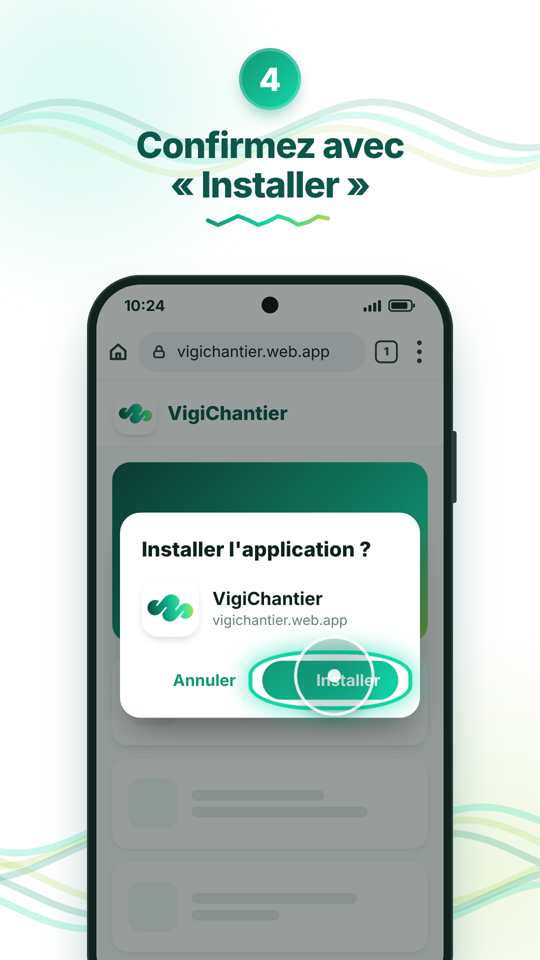
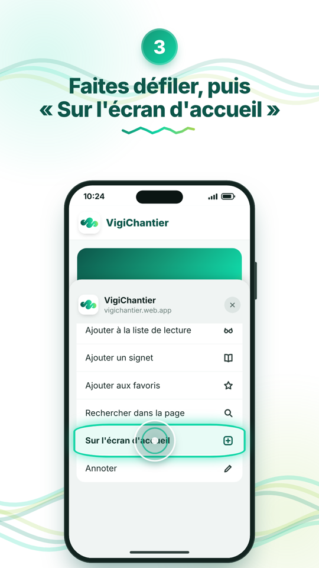

# Tutoriels « Installer l'application » (PWA) : Android et iPhone

Deux vidéos verticales en motion design, aux couleurs de **Synapsis**. Elles montrent pas à pas à un client
non technique comment installer une application web (PWA) sur son téléphone.

| Vidéo | Durée | Fichiers |
|---|---|---|
| Android / Chrome | 27,6 s | [`output/tuto_android_chrome.mp4`](output/tuto_android_chrome.mp4) · [GIF](output/tuto_android_chrome.gif) · [vignette](output/tuto_android_chrome.png) |
| iPhone / Safari | 29,3 s | [`output/tuto_iphone_safari.mp4`](output/tuto_iphone_safari.mp4) · [GIF](output/tuto_iphone_safari.gif) · [vignette](output/tuto_iphone_safari.png) |

Format : 1080×1920, 30 i/s, H.264, sans son. Les GIF font 320 px de large à 10 i/s, environ 2,5 Mo.

<p>
  
  
</p>

## Le déroulé

**Android (Chrome)**
1. Ouvrez le lien dans Chrome.
2. Touchez les 3 points en haut à droite.
3. Touchez « Installer l'application » (ou, selon le téléphone, « Ajouter à l'écran d'accueil »).
4. Confirmez avec « Installer ».
5. C'est prêt ! L'icône apparaît, on l'ouvre comme n'importe quelle application.

**iPhone (Safari)**
1. Ouvrez le lien dans Safari (pas Chrome, pas Instagram : uniquement Safari).
2. Touchez le bouton Partager en bas (parfois dans le menu •••).
3. Faites défiler, puis touchez « Sur l'écran d'accueil ».
4. Touchez « Ajouter » en haut à droite.
5. C'est prêt ! L'app est sur l'écran d'accueil.

Chaque vidéo a la même structure :
- une **intro** où les courbes du logo se dessinent ;
- une **vague du logo** comme transition ;
- les étapes, chacune avec sa pastille numérotée, son titre et le geste du doigt ;
- une **outro** « Une question ? Contactez-nous ».

Pour le geste, un cercle translucide se déplace puis touche l'écran avec une onde. Un halo pulse sur la cible.

## Identité visuelle

Les couleurs ont été extraites du logo (`assets/logo_synapsis.png`) :

| Couleur | Usage |
|---|---|
| `#0D564A` vert profond | titres, textes forts |
| `#149776` émeraude | pastilles, boutons |
| `#11D7A7` menthe | halo, onde du doigt, dégradés |
| `#A5D657` vert lime | fin des dégradés, accents |

Le reste de l'identité reprend aussi le logo :
- le **S fluide** et ses ondulations servent de motif aux rubans de fond, aux séparateurs et aux transitions ;
- les fonds sont blancs, avec de grandes zones de respiration ;
- la police est **Inter**, embarquée en local (`assets/fonts/`).

Les téléphones sont génériques, en CSS : aucun logo Apple ni Google.

## Réutiliser les vidéos pour une autre application

Il suffit de modifier [`config.json`](config.json) :

```json
{
  "appName": "VigiChantier",
  "url": "vigichantier.web.app",
  "icon": "assets/app-icon.png",
  "outroText": "Une question ? Contactez-nous",
  "contact": "synapsis-btp.fr"
}
```

| Clé | Effet |
|---|---|
| `appName` | Nom affiché dans l'intro, les fenêtres d'installation et sous l'icône. |
| `url` | Adresse tapée dans la barre du navigateur. |
| `icon` | Icône de l'app, carrée, de 512×512 conseillé. Placez le fichier dans `assets/`. |
| `outroText` | Texte de fin. La partie après « ? » passe en dégradé, sur une deuxième ligne. |
| `contact` | Ligne de contact sous le texte de fin. Laissez `""` pour la masquer. |

Ensuite, relancez `npm run render`.

## Installation

Il faut **Node.js 18 ou plus récent** et **ffmpeg**.

```bash
cd tuto-pwa
npm install                       # installe GSAP et Playwright
npx playwright install chromium   # navigateur utilisé pour le rendu (une seule fois)
```

ffmpeg, s'il n'est pas déjà présent :
- Linux (Debian/Ubuntu) : `sudo apt install ffmpeg`
- macOS : `brew install ffmpeg`
- Windows : `winget install ffmpeg`

## Prévisualiser

```bash
npm run dev
```

Ouvrez ensuite l'adresse affichée :
- <http://localhost:5173/src/index.html?tuto=android>
- <http://localhost:5173/src/index.html?tuto=ios>

Une barre en bas de l'écran sert à lire et mettre en pause (touche **Espace**) et à naviguer dans la timeline
image par image. Elle permet aussi de passer d'Android à iPhone. Ajoutez `&t=12.5` à l'adresse pour ouvrir
directement à 12,5 s.

## Générer les vidéos

```bash
npm run render           # les deux vidéos
npm run render:android   # Android seulement
npm run render:ios       # iPhone seulement
npm run stills -- 3,9.5  # quelques images clés dans frames/stills/ (vérification rapide)
```

Le rendu prend environ 2 à 3 minutes par vidéo. Il crée, dans `output/` :
- la vidéo `.mp4` ;
- un GIF léger `.gif` (option `--no-gif` pour le sauter) ;
- une vignette `.png`.

Le rendu est **déterministe**. Playwright ouvre la page en 1080×1920, avance la timeline GSAP image par
image (30 i/s) et enregistre chaque image en PNG. ffmpeg assemble ensuite ces images. Ce n'est pas une
capture d'écran en temps réel : le même code donne toujours la même vidéo.

Les images temporaires vont dans `frames/`, qui est ignoré par git. Pour accélérer le rendu sur une
machine puissante, utilisez la variable `WORKERS` (4 par défaut) : `WORKERS=8 npm run render`.

## Organisation

| Chemin | Rôle |
|---|---|
| `config.json` | Paramètres de l'application présentée. |
| `src/index.html` | Page unique ; `?tuto=android` ou `?tuto=ios` choisit le tutoriel. |
| `src/styles.css` | Charte (variables de couleur dans `:root`), typographie, téléphones et écrans. |
| `src/js/ui.js` | Briques communes : logo animé, vagues, en-têtes d'étape, doigt, halo, zoom caméra. |
| `src/js/android.js` | Écrans Chrome et déroulé Android. |
| `src/js/ios.js` | Écrans Safari et déroulé iPhone. |
| `src/js/main.js` | Intro, outro, transitions. Construit **une seule timeline GSAP**, en pause, exposée en `window.tl`. |
| `scripts/render.mjs` | Rendu image par image, puis MP4, GIF et vignette. |
| `scripts/dev.mjs` | Serveur de prévisualisation. |
| `assets/` | Logo, icône de l'app, police Inter. |
| `output/` | Vidéos finales (versionnées). |

### Modifier un texte ou le rythme

- **Textes des étapes** : tableau `STEPS` en haut de `src/js/android.js` et de `src/js/ios.js`.
  - Pas plus de 6 mots par ligne.
  - Les lignes trop longues sont réduites automatiquement, sans jamais descendre sous 56 px.
- **Durées** : chaque étape est construite à la suite de la précédente dans ces mêmes fichiers. La durée
  totale s'adapte toute seule.
