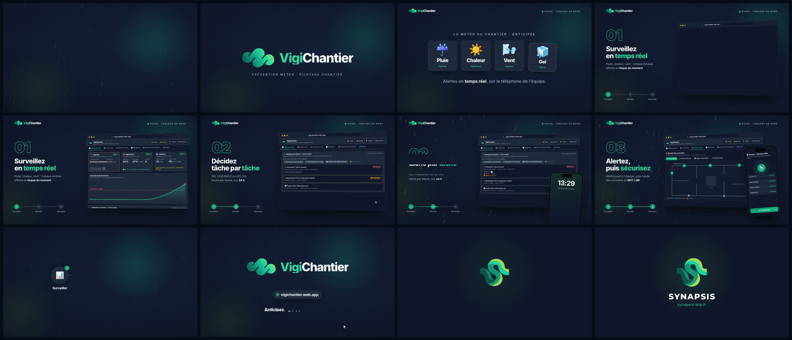

# Motion design VigiChantier (15 s + signature Synapsis)



**Vidéo :** [`out/vigichantier_motion.mp4`](out/vigichantier_motion.mp4)
(1920×1080, 60 i/s, H.264 + AAC, 18,75 s) : présentation de VigiChantier en 3 temps
(surveiller, décider, sécuriser), puis 3,75 s de signature Synapsis.

Scénario, sources, fidélité au site et sound design : [`SCENARIO.md`](SCENARIO.md).

Même moteur que la vidéo FluxChantier, à la racine du dépôt :
- `src/index.html` : décor et reproduction des écrans ; les **couleurs Synapsis** sont dans `:root` ;
- `src/anim.js` : `seek(t)` pose chaque élément à l'instant `t` ;
- `src/timeline.js` : instants clés partagés par l'image et le son ;
- `scripts/render.mjs` : capture image par image avec Chromium headless ;
- `scripts/audio.py` : synthèse de la musique et des bruitages ;
- `scripts/build.sh` : son, images manquantes, MP4, affiche et storyboard.

```bash
# depuis la racine du dépôt : npm install (playwright) et pip install numpy, une fois
bash vigichantier/scripts/build.sh            # -> vigichantier/out/vigichantier_motion.mp4
node vigichantier/scripts/render.mjs --stills 5.6,8.6,11.95   # images de contrôle
```

Aperçu en temps réel : servir `vigichantier/src/` (par exemple `npx http-server vigichantier/src`) ;
ajouter `?t=8.6` à l'URL pour figer une image.
